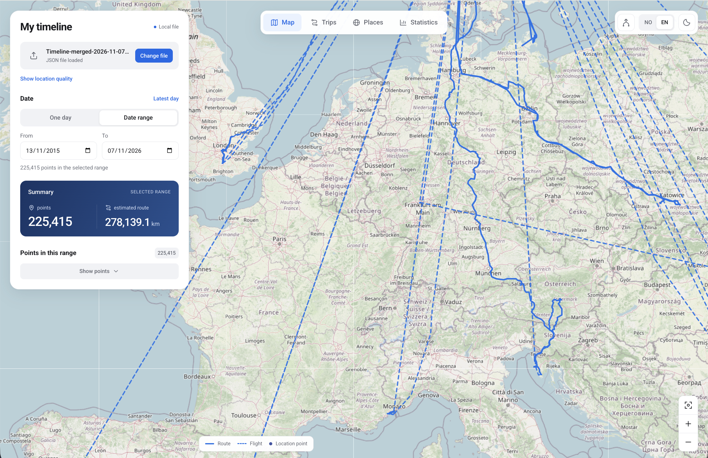
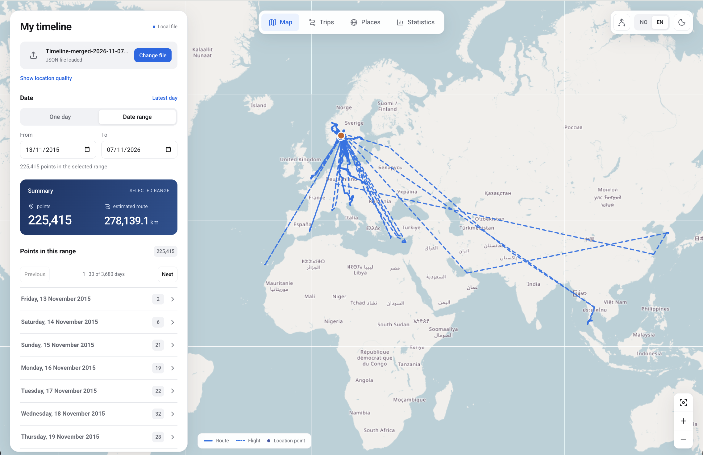
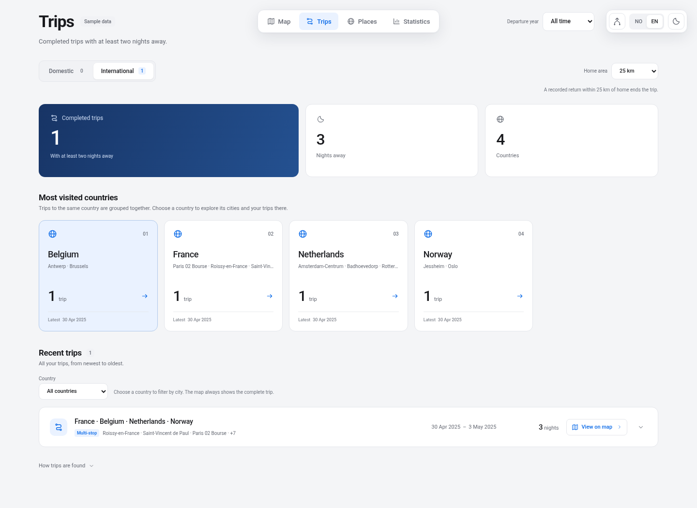
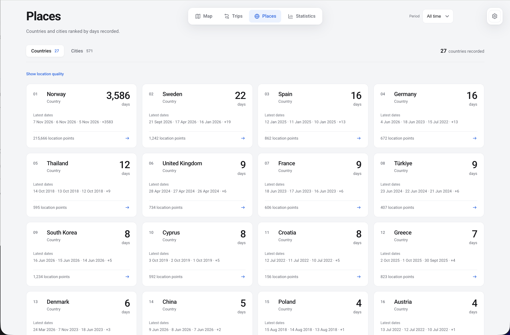
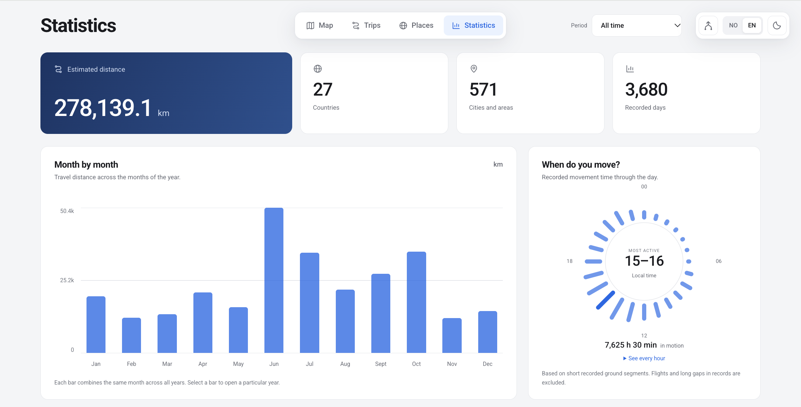
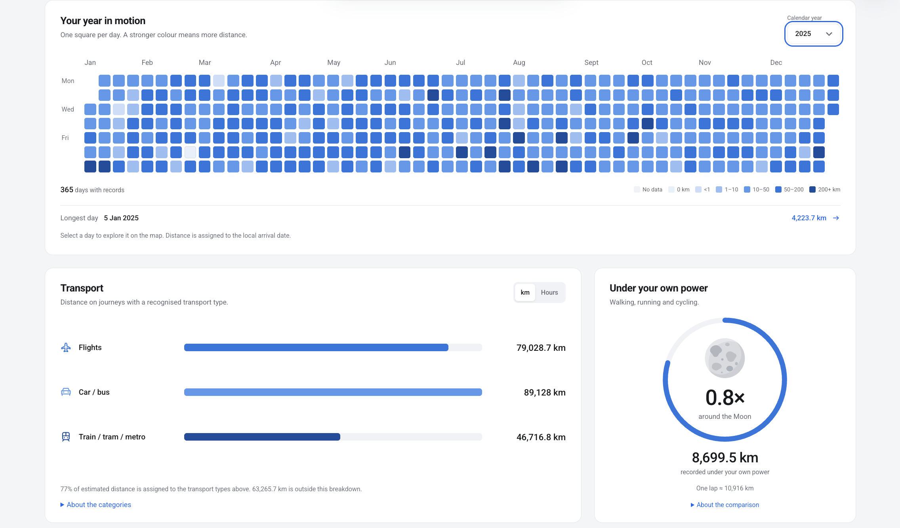

# Timeline Explorer

A Google Maps Timeline viewer for exploring your Google Location History on an interactive map. Import Timeline or Google Takeout JSON exports, view travel statistics, and merge exports locally in your browser.

<!-- To replace these screenshots, see docs/SCREENSHOTS.md. -->

## Get started

1. Open [Timeline Explorer](https://knukev.github.io/Timeline_explorer/) and try the fictional London–Paris–Amsterdam–Oslo–London journey. No installation or account is needed.
2. To explore your own history, open **Map → Choose file** and select a Google Timeline JSON export. Mobile Timeline exports and older Takeout files such as `Records.json` are supported. Unzip archived exports first.

Your file stays in browser memory and is never uploaded to GitHub. Refreshing the page clears it. The selected map provider (OpenStreetMap or EOX) receives tile requests for the area you view.

## Explore your history

- **Map** shows routes for a day or date range. Dashed lines mark flights.
- **Trips** groups domestic and international journeys with at least two nights away. The default home radius is 25 km or 15 mi, depending on your distance units. A recorded return to the home area ends the trip. Use **Set home location** next to **Home area** to place a pin on the map. Choose **Entire history** or set an **Applies from** date. If you have moved, add a pin and start date for each home. Each pin applies until the next start date, and earlier dates use automatic home detection. Your choices are saved in your browser.
- **Places** ranks countries and cities by recorded days. Click tiles to show movement in the selected area. Places with fewer than 10 points are in a collapsible section at the bottom.
- **Statistics** shows monthly distance, a calendar coloured by distance, movement by time of day, recognised transport by distance or recorded travel time, and your most frequent routes between cities. **Under your own power** combines walking, running and cycling distance, compared with a lap around the Moon. These are estimates from recognised records; transport coverage is shown below the bars.

## Mobile layout

On smaller screens, the four tabs sit in a navigation bar at the bottom. In **Map**, drag the panel up to change the date range, see the route summary, or import a file. When the panel reaches the top, scroll to see the rest of its contents. In **Statistics**, **Year in motion** shows the year as twelve mini calendars. Tap a day with recorded data to open it on the map.

## Combine Timeline files

Click the **Merge** icon in settings, choose two Timeline JSON files, and download the combined file. The originals stay unchanged. Duplicate records are removed, missing data is filled from either file, and conflicting values are preserved. Open the downloaded JSON with **Map → Choose file**.

## Export routes and location points

Open **Settings → Export timeline**. Choose a date range or select all dates, then download KML for Google Earth, GPX for GPS apps, or GeoJSON for mapping tools. The export is created locally in your browser. Suspicious location points are excluded by default. If the selected dates contain any, select **Include suspicious location points** to include them.

Routes, flights, visited places, and other location points appear in separate folders in the KML file. Point markers appear without labels on the map.

## Run locally

Install **Node.js 24 with npm**, clone this repository or extract the ZIP, then run `npm ci` and `npm run dev` in the project folder. Open the local address printed in the terminal.

## Screenshots & Feature Highlights

Below are previews of the main views in Timeline Explorer:

### Interactive Map View

Filter travel history by custom date ranges, view location quality, and trace flight routes (dashed lines) alongside ground travel.

### Trip Detection

Automatically detects completed domestic and international trips with at least two nights away from home. Cards group journeys by country and display multi-stop itineraries.

### Places & Location Ranks

Rank and explore visited countries, regions, and cities sorted by total days spent. Filter or click any location tile to highlight recorded movements in that specific area.

### Travel Statistics - Total Stats, Monthly Overview, Activity Calendar and Transport Stats

Visualize total recorded distance, monthly travel patterns, time-of-day activity levels, daily distance intensity across the calendar year, transport mode breakdowns with distance, human-powered travel distance compared against a lap around the Moon, and your most traveled routes.

## Credits

Map data © [OpenStreetMap contributors](https://www.openstreetmap.org/copyright). Satellite imagery from [EOxCloudless](https://cloudless.eox.at) by EOX IT Services GmbH (contains modified Copernicus Sentinel data 2016). Place names from [GeoNames](https://www.geonames.org/) (CC BY 4.0). Country outlines from Natural Earth via `world-atlas`. Low-zoom land cover from [Natural Earth I with Shaded Relief](https://www.naturalearthdata.com/downloads/50m-raster-data/50m-natural-earth-1/). [Roboto font license](public/fonts/OFL.txt).
